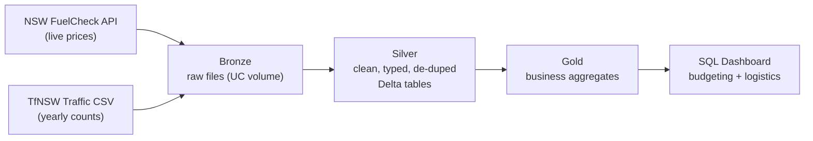

<aside>
⛽

**NSW Fuel Price Project** turns two free NSW open-data feeds — live fuel prices and yearly road-traffic volumes — into a decision-support dashboard for **fuel-cost budgeting** and **freight-corridor planning**. Built on **Databricks Serverless + Unity Catalog** using an idempotent **medallion** (bronze → silver → gold) pipeline.

</aside>

## 1. Business context

Fuel is the single biggest *variable* cost in logistics, and the roads goods travel on drive both delivery time and route cost. Pairing a **live** fuel-price feed with a **strategic** historical traffic feed tells a story neither can alone.

**Who it's for:** small-to-medium businesses managing supply chains and budgets, plus individuals and families budgeting for fuel in regional NSW.

**Two questions it answers:**

- **Budgeting** — Where are fuel prices heading, and what should I provision for next month?
- **Route planning** — Which corridors carry the heaviest freight load, and how do fuel prices look along them?

## 2. Data sources

| Source | What | Cadence | Access |
| --- | --- | --- | --- |
| **NSW FuelCheck / Fuel API** | Live fuel prices for every registered NSW service station | Live / operational | 2-step OAuth + mandatory headers |
| **TfNSW Traffic Volume Viewer** | Annual vehicle counts by class, direction & period (~1,900 stations since 2006) | Yearly / strategic | Bulk CSV, manually uploaded |

<aside>
🧭

The mismatched horizons (live vs. yearly) are a feature, not a bug — they get paired at the gold / dashboard layer.

</aside>

## 3. Architecture

A classic **medallion** pattern adapted for a **Serverless + Unity Catalog** workspace — no cluster to babysit, no storage account or access keys to manage. Raw files land in a UC managed **volume**; silver and gold are managed **Delta tables**.

| Layer | Purpose | Stored as |
| --- | --- | --- |
| 🥉 Bronze | Raw, untouched ingest, exactly as pulled | Files in a UC volume |
| 🥈 Silver | Cleaned, typed, de-duplicated, conformed | Managed Delta tables |
| 🥇 Gold | Business-ready aggregates for dashboards | Managed Delta tables |

## 4. Notebook structure

The pipeline lives in one notebook, organised into ordered sections:

| Section | Role |
| --- | --- |
| `00_manualcleanup` | **Dev-only / recovery.** Landing-inbox clear, full-rebuild drop, one-time deprecated-table drop, and a safe gold-prune script. Never scheduled. |
| `01_bronze` | Create catalog / schemas / volume, then ingest raw fuel (API) + traffic (CSV). Append-only. |
| `02_silver` | Transform bronze → silver via **MERGE** (idempotent upserts, de-dup, typing). |
| `03_gold` | Build business aggregates from silver via deterministic `overwrite`. |

## 5. Idempotency design (the core principle)

The pipeline is built so that **re-running any layer is safe and produces the same result** — no duplicates, no accidental data loss.

- **Bronze is append-only.** Each API pull writes a new timestamped file (`fuel_<ts>.json`), preserving an immutable raw audit trail. Routine deletion was removed.
- **Silver ingests only new/changed rows via MERGE.** Prices insert-only on `(station_code, fuel_type, updated_at)`; stations upsert on `station_code`; traffic merges on its natural grain. Re-runs never duplicate observations.
- **Gold is fully derived and rebuilt with `overwrite` / `CREATE OR REPLACE`.** Because it's deterministic from silver, a full rebuild is idempotent and only touches targeted gold tables.
- **Full reset is quarantined.** "Drop everything and rerun" lives under `00_manualcleanup` and is reserved for schema redesign, corrupted state, or controlled backfills.

<aside>
♻️Rule of thumb: rebuild only the layer whose logic changed. Bronze accumulates, silver merges, gold overwrites.

</aside>

## 6. Gold tables & lineage

The dashboard reads three gold tables directly. The heavy intermediates are built **in-memory** during the `03_gold` run (not persisted), so re-runs are self-contained and there are no orphan tables to maintain.

| Table | Read by dashboard? | Notes |
| --- | --- | --- |
| `gold.fuel_price_trends` | ✅ Direct | Hourly avg/min/max price per fuel type (budgeting time series) |
| `gold.servo_corridor` | ✅ Direct | Each servo paired with its nearest freight corridor (Haversine spatial join) |
| `gold.map_layer` | ✅ Direct | Servos + corridors stacked as separate points for one combined map |
| `gold.heavy_daytype_by_corridor` | ✅ Direct | Dashboard dataset (protected) |
| `servo_map_df` / `corridor_load_df` / `heavy_by_period_df` | ⚙️ In-memory | Intermediates computed at runtime; **not** persisted as tables |

<aside>
**`period` is a filter, never a sum.** Traffic buckets (`ALL DAYS`, `WEEKDAYS`, `WEEKENDS`, peaks, holidays) overlap — slice by one period at a time; adding them double-counts. Likewise, never sum across `classification_type` (`ALL VEHICLES` overlaps light + heavy).

</aside>

## 7. How to run

**Prerequisites**

- Databricks Serverless workspace with Unity Catalog
- NSW Fuel API key + secret stored in a secret scope named `medallion` (keys: `nsw_fuel_key`, `nsw_fuel_secret`)
- Traffic Volume Viewer CSV uploaded to `medallion.bronze.landing/traffic`

**Order**

1. Run `01_bronze` once to create the catalog / schemas / volume, then to ingest raw data.
2. Run `02_silver` to build the cleaned Delta tables (safe to re-run daily).
3. Run `03_gold` to build the dashboard aggregates.
4. Point a serverless SQL warehouse / dashboard at the gold tables.

<aside>
🔑Secrets are read with `dbutils.secrets.get("medallion", ...)` — never hardcode keys. Set the scope up once via the Databricks CLI.

</aside>

## 8. Maintenance & safety rails (`00_manualcleanup`)

- **Landing-inbox clear** — only for dev/test; bronze raw history is otherwise preserved.
- **Full silver/gold rebuild** — recovery / schema-redesign only.
- **One-time deprecated-table drop** — removes the old materialised intermediates (`servo_fuel_map`, `freight_corridor_load`, `heavy_by_period`) that are now in-memory.
- **Gold prune (allowlist + dry-run)** — lists a `PROTECTED` keep-set of dashboard tables and drops any other gold table. Defaults to `DRY_RUN = True` so you preview before deleting.

<aside>
🛡️Protected (never pruned): `fuel_price_trends`, `servo_corridor`, `map_layer`, `heavy_daytype_by_corridor`. Add a name to `PROTECTED` only if you re-materialise an intermediate the build reads back.

</aside>

## 9. Dashboard

A Databricks SQL dashboard organised for two personas, embedded outside Databricks via a small Flask + React app on Azure App Service (free tier) using the AI/BI embedding SDK.

- **💰 Budgeting view** — fuel cost index over time, current-price counters, cheapest-brand bars.
- **🚚 Logistics view** — servo map with price + nearest-corridor tooltips, and freight load by period.

## 10. Tech stack

Databricks Serverless · Unity Catalog · PySpark · Delta Lake · Databricks SQL · Flask + React (embedding) · Azure App Service.

## 11. Governance & next steps

If this moved from a personal build to a shared product: least-privilege UC access, dev/test/prod separation, dataset owners + freshness SLAs, data-quality expectations, UC lineage + table comments, PR review for gold logic, and cost guardrails on serverless usage.

**Stretch goals:** fuel-spend scenario calculator (litres/month × diesel price, ±10¢ sensitivity), Delta Live Tables / Lakeflow migration, and a Melbourne (VIC) extension.
